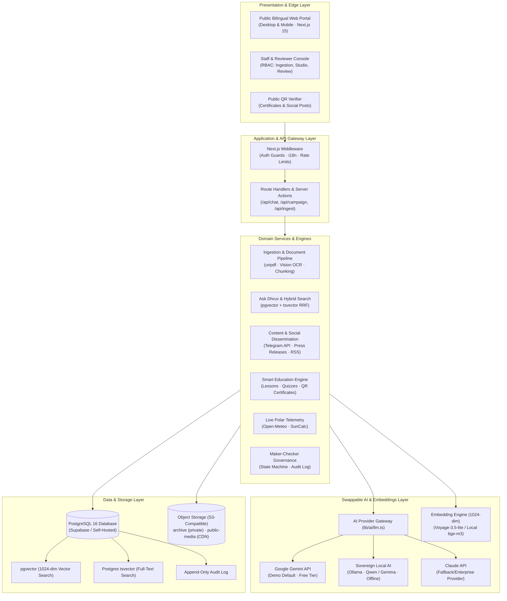

# DHRUV · System Architecture, Tech Stack & Services Report

> **Problem Statement ID:** SIH26063 (Ministry of Earth Sciences / NCPOR, Goa)  
> **Platform Name:** DHRUV — Integrated Polar Science Outreach, Knowledge Repository and Media Dissemination Portal  
> **Motto:** *"Upload once. Archive forever. Publish everywhere."*  
> **Target Audience:** General Public, Students (Classes 6–12), Polar Scientists, Outreach Officers, Media Cells  

---

## 1. Executive Summary

**DHRUV** is an integrated polar science outreach portal and digital repository engineered for the **National Centre for Polar and Ocean Research (NCPOR)** under the **Ministry of Earth Sciences (MoES)**. India has maintained continuous scientific expedition presence across the Arctic, Antarctic, and the Himalayas since 1981 (spanning stations such as Maitri, Bharati, Himadri, and Himansh). However, research findings, expedition reports, scientific datasets, and multimedia were historically scattered across unstructured PDFs, technical publications, YouTube videos, and disparate archives.

DHRUV unifies these assets under a single AI-assisted platform. When staff upload a scientific asset (report, publication, dataset, video, or photo):
1. **Automated Multimodal Ingestion:** Extracts text, analyzes figures/captions, splits documents into page-attributed chunks, and creates vector embeddings.
2. **Bilingual Synthesis:** Generates high-fidelity summaries (scientific, simple, and Hindi), SEO keywords, and accessible alt text.
3. **Multi-Channel Media Dissemination:** Synthesizes ready-to-publish social campaigns (X/Twitter, LinkedIn, Instagram, Facebook, Telegram) and press releases with strict **two-person ("maker-checker") human governance**.
4. **Verifiable Smart Education:** Formulates curriculum-aligned lessons (Classes 6–8, 9–10, 11–12) with server-evaluated interactive quizzes and tamper-evident QR-verifiable certificates.
5. **Cited Polar Assistant ("Ask Dhruv"):** Provides conversational answers strictly grounded in polar archive sources, citing exact PDF pages and video timestamps.

---

## 2. System Architecture

DHRUV adopts a **modular, service-oriented architecture** (packaged as a cohesive Next.js 15 application paired with decoupled asynchronous worker pipelines and a PostgreSQL vector database). This avoids unnecessary microservice networking overhead while maintaining strict domain boundary isolation, low operational cost, and full data sovereignty for government deployments.

### 2.1 Architectural Flow Diagram



### 2.2 Design Principles
- **Open-Source and Zero-Cost-to-Run:** Built exclusively on MIT/Apache-2.0 technologies (Next.js, PostgreSQL, pgvector, self-hostable Supabase).
- **Strict Data Sovereignty:** Supports a complete offline "Sovereign Mode" using Ollama (`qwen3:4b`/`gemma3:4b`) and `bge-m3` multilingual embeddings.
- **Truthful Attributions:** No invented datelines, no fabricated affiliations, and no automated publishing without human sign-off.
- **Accessibility & Mobile-First:** Compliant with GIGW / WCAG 2.1 AA (0 automated axe-core violations), fluid rendering on 4G mobile connections.

---

## 3. Technology Stack

| Category | Technology / Library | Version / Details | Purpose |
|---|---|---|---|
| **Core Framework** | [Next.js](https://nextjs.org/) | `15.2.0` (App Router) | Full-stack server/client runtime, Server Components & Actions |
| **Language** | [TypeScript](https://www.typescriptlang.org/) | `5.7.3` (Strict Mode) | End-to-end type safety across database schemas, APIs, and AI outputs |
| **UI & Styling** | [Tailwind CSS](https://tailwindcss.com/) | `v4.0.0` | Deep polar color palette tokens (`--navy`, `--glacier`, `--snow`) |
| **Component Primitives** | [shadcn/ui](https://ui.shadcn.com/) / Radix | Modern React 19 primitives | Accessible UI dialogs, accordions, dropdowns, and cards |
| **Icons** | [Lucide React](https://lucide.dev/) | `0.475.0` | Uniform vector iconography |
| **Motion & 3D** | [Three.js](https://threejs.org/) / [react-globe.gl](https://github.com/vasturiano/react-globe.gl) | `0.186.1` / `2.27.2` | Interactive 3D polar globe displaying Indian stations & daylight |
| **Animation & Scroll** | [Framer Motion](https://www.framer.com/motion/) / [Lenis](https://lenis.darkroom.engineering/) | `12.4.7` / `1.3.26` | Hardware-accelerated 60/120 fps transitions and smooth scrolling |
| **Database & Auth** | [PostgreSQL](https://www.postgresql.org/) + [Supabase](https://supabase.com/) | PG 16 / `@supabase/ssr 0.5.2` | Relational storage, Auth (Magic link/passwords), Row Level Security (RLS) |
| **Vector Engine** | [pgvector](https://github.com/pgvector/pgvector) | `1024-dimensional` | High-performance cosine similarity indexing for hybrid search |
| **AI Runtime Gateway** | Unified Provider ([`lib/ai/llm.ts`](file:///e:/PS%2063/lib/ai/llm.ts)) | Multi-driver architecture | Swappable AI between Gemini, Ollama, and Claude with zero business-code changes |
| **Hosted AI Models** | Google Gemini (`@google/genai`) | `gemini-2.5-flash` | Hosted tier for rapid PDF reading, OCR, summarization, and RAG |
| **Sovereign AI Models** | [Ollama](https://ollama.ai/) | Qwen3 / Gemma3 / `bge-m3` | 100% offline self-hosted AI inference for sovereign/air-gapped nodes |
| **Embeddings** | [Voyage AI](https://www.voyageai.com/) / `bge-m3` | `1024-dimensional` | Multilingual document and query vectorization |
| **Document Parsing** | [unpdf](https://github.com/unjs/unpdf) | `1.8.1` | Server-side PDF text and metadata extraction with page numbering |
| **Validation** | [Zod](https://zod.dev/) | `3.24.2` | Strict runtime schema validation for LLM structured outputs |
| **Internationalization** | [next-intl](https://next-intl.dev/) | `4.14.7` | Full English (`en`) and Hindi (`hi`) dual-language parity |
| **Environmental Feeds** | [Open-Meteo](https://open-meteo.com/) / [SunCalc](https://github.com/mourner/suncalc) | Free Open API / `1.9.0` | Real-time weather and daylight calculation for polar stations |
| **E2E & Testing** | [Playwright](https://playwright.dev/) / [Axe-Core](https://www.deque.com/axe/) | `1.63.0` / `4.13.0` | E2E browser verification and WCAG 2.1 AA accessibility audits |

---

## 4. Microservices & Functional Subsystems

Although packaged within a unified codebase for lightweight operational maintenance, DHRUV is cleanly divided into **8 decoupled domain services**:

```
                              ┌──────────────────────────────────────┐
                              │           DHRUV Core Engine          │
                              └──────────────────┬───────────────────┘
         ┌───────────────┬───────────────────────┼───────────────────────┬───────────────┐
         ▼               ▼                       ▼                       ▼               ▼
   [01 Ingestion]  [02 RAG / Chat]       [03 Dissemination]       [04 Education]  [05 Telemetry]
         │               │                       │                       │               │
         ▼               ▼                       ▼                       ▼               ▼
   [06 Governance] [07 Harvester]         [08 Gap Insights]       [Storage/CDN]   [DB & pgvector]
```

### 4.1 Ingestion & Document Processing Service ([`lib/ai/ingest.ts`](file:///e:/PS%2063/lib/ai/ingest.ts))
- **Signed Browser Uploads:** Large files bypass Next.js API limits by uploading directly from the browser to Supabase Storage via pre-signed URLs.
- **Multimodal Parser:**
  - Standard PDFs: Parsed via `unpdf` into ~800-token chunks with 100-token overlap, preserving exact page indices.
  - Scanned Documents / Maps: Processed using AI vision OCR.
  - Video Assets: Transcribed with key chapter timestamps.
  - Tabular Datasets: CSV structure analyzed, producing summary tables and monthly visual charts.
- **Automated Cataloguer:** Produces bilingual titles, summaries, keywords, alt text, and inferred expedition/station associations.

### 4.2 AI & Hybrid Search (RAG) Service ([`lib/ai/chat.ts`](file:///e:/PS%2063/lib/ai/chat.ts))
- **Hybrid Retrieval:** Merges semantic similarity (`pgvector` cosine distance) and lexical relevance (`tsvector` full-text search) via **Reciprocal Rank Fusion (RRF)**.
- **Source-Grounded Answering:** Prompts enforce strict grounding—answers cite sources directly (e.g., `[Source 1: Page 14]`).
- **Honest Refusal:** If context similarity is below threshold, Dhruv responds with an honest *"I don't have this in the archive"* rather than hallucinating.
- **Continuous Evaluation:** Benchmarked against a 32-question verified test set (accessible publicly at `/accuracy`).

### 4.3 Content Dissemination & Publishing Service ([`lib/ai/campaign.ts`](file:///e:/PS%2063/lib/ai/campaign.ts), [`lib/social/telegram.ts`](file:///e:/PS%2063/lib/social/telegram.ts))
- **Cross-Platform Synthesizer:** Converts verified scientific reports into tailored drafts for X/Twitter, LinkedIn, Instagram, Facebook, and PIB-style press releases.
- **Automated Telegram Broadcaster:** Posts directly to designated public channels using the Telegram Bot API upon approval.
- **Digital Provenance QR Codes:** Generates tamper-evident QR codes for each approved social post and press release. Scanning verifies authenticity at `/verify`.
- **Public Syndication:** Automatically outputs bilingual RSS/Atom feeds at `/news/rss.xml`.

### 4.4 Smart Education & Certification Service ([`lib/ai/lesson.ts`](file:///e:/PS%2063/lib/ai/lesson.ts))
- **Curriculum-Grounded Generator:** Formulates educational modules customized for Classes 6–8, 9–10, and 11–12 based on actual expedition logs and scientific discoveries.
- **Server-Side Grading:** Multiple Choice Quizzes (MCQs) are evaluated strictly on the server; answer keys are never sent to the browser client.
- **Verifiable Certificates:** Passing students (≥80% score) receive a digital certificate equipped with a unique UUID and verification QR code.

### 4.5 Live Polar Telemetry & Environmental Service ([`lib/live/polar.ts`](file:///e:/PS%2063/lib/live/polar.ts), [`lib/live/sun.ts`](file:///e:/PS%2063/lib/live/sun.ts))
- **Station Telemetry:** Fetches live temperature, wind speed, and conditions for India's polar bases:
  - *Maitri* (Antarctica, 70°46′S 11°44′E)
  - *Bharati* (Antarctica, 69°24′S 76°11′E)
  - *Himadri* (Svalbard, Arctic, 78°55′N 11°56′E)
  - *Himansh* (Spiti, Western Himalaya, 32°24′N 77°37′E)
- **Solar Zenith Calculations:** Uses `suncalc` to calculate polar day/night cycles and real-time solar elevation angles.

### 4.6 Governance & Maker-Checker Service ([`lib/db/workflow.ts`](file:///e:/PS%2063/lib/db/workflow.ts))
- **Role-Based Access Control (RBAC):** Five strict roles: `super_admin`, `scientist`, `outreach_officer`, `reviewer`, `public`.
- **State Machine Enforcement:** Posts and campaigns traverse through:
  $$\text{Draft} \longrightarrow \text{In Review} \longrightarrow \text{Approved} \longrightarrow \text{Scheduled} \longrightarrow \text{Published}$$
- **Anti-Collusion Governance:** A staff member who creates or edits a draft cannot approve it (maker $\ne$ checker).
- **Immutable Audit Trail:** Logs all administrative and editorial actions in `audit_log`.

### 4.7 Automated Harvester & Ingestion Feeds ([`lib/harvest/feeds.ts`](file:///e:/PS%2063/lib/harvest/feeds.ts))
- **External Repository Integration:** Connects with the **National Polar Data Center (NPDC)**, DSpace repository, OpenAlex academic papers, and official YouTube channels.
- **Metadata Harvesting:** Collects research publications, open-access licenses, and video metadata without illegally duplicating copyrighted raw binaries.

### 4.8 Analytics & Content Gap Intelligence Service ([`lib/insights.ts`](file:///e:/PS%2063/lib/insights.ts))
- **Content Gap Detector:** Logs user questions where Ask Dhruv had low retrieval confidence or answered "unresolved".
- **Editorial Demand Radar:** Surfaces trending scientific queries to outreach officers, providing a 1-click action to draft new educational explainers addressing audience knowledge voids.

---

## 5. Database Schema & Data Models

PostgreSQL serves as the single source of truth, utilizing `pgvector` for vector persistence and Supabase Auth with Row Level Security (RLS) policies.

```
                              ┌────────────────────────┐
                              │        profiles        │
                              │ (id, role, full_name)  │
                              └───────────┬────────────┘
                                          │ 1:N
         ┌────────────────────────────────┼────────────────────────────────┐
         │ 1:N                            │ 1:N                            │ 1:N
         ▼                                ▼                                ▼
  ┌───────────────┐               ┌───────────────┐                ┌───────────────┐
  │  expeditions  │               │    assets     │                │   audit_log   │
  │ (code, region)│◄──────────────┤(type, licence)│───────────────►│(action, actor)│
  └───────┬───────┘ 0..1:N        └───────┬───────┘ 1:N            └───────────────┘
          │                               │
          │ 0..1:N           ┌────────────┴────────────┐
          ▼                  ▼                         ▼
   ┌─────────────┐   ┌───────────────┐         ┌───────────────┐
   │  stations   │   │ asset_chunks  │         │ content_posts │
   │ (name, lat) │   │ (vec, tsvec)  │         │ (channel, txt)│
   └─────────────┘   └───────────────┘         └───────────────┘
```

### Key Tables Overview:
1. **`assets`**: Base record for all content (`report`, `dataset`, `publication`, `photo`, `video`, `event`, `news`). Tracks multilingual titles/summaries, licenses, credits, station, and expedition links.
2. **`asset_chunks`**: Text passages with `vector(1024)` embeddings and `tsvector` lexemes for hybrid indexing, tagged with `page` numbers and video timestamps (`start_s`/`end_s`).
3. **`expeditions` & `stations`**: Spatial-temporal records of Indian polar research, including coordinates, GeoJSON route maps, and timeline dates.
4. **`content_posts`**: Social campaigns and website articles. Stores platform targeting (`x`, `linkedin`, `instagram`, `facebook`, `telegram`, `blog`), review status, and scheduled timestamps.
5. **`lessons`, `quizzes`, `quiz_attempts`**: Educational curricula, questions, server-validated options, and student attempt scores.
6. **`chat_logs`**: RAG query audit table storing user questions, response confidence scores, cited asset IDs, and locale.
7. **`audit_log`**: Tamper-evident ledger recording administrative actions, role transitions, and approvals.

---

## 6. Security, Governance & Verification

1. **Row-Level Security (RLS):**
   - Public anonymous requests can only query records where `status = 'published'` and `access_level = 'public'`.
   - Internal drafts, pending campaigns, and audit logs require authenticated session tokens with designated roles (`outreach_officer`, `reviewer`, `super_admin`).
2. **Anti-Hallucination Guardrails:**
   - LLM generation uses constrained temperature settings and strict system instructions forbidding fabricated facts.
   - Structured JSON responses are strictly validated through Zod runtime validators before database insertion.
3. **Dual Verification Architecture:**
   - **Certificate Verification:** Public URL `/verify/[id]` checks student certificates against immutable quiz logs.
   - **Media Provenance Verification:** QR code on every approved press release/social post maps back to the approved database record, defeating misinformation.
4. **Zero-Trust File Uploads:**
   - User-supplied files are uploaded to isolated, virus-safe Supabase Storage buckets with strict MIME-type and size validations.

---

## 7. Deployment & Operations

### 7.1 Local Development & Testing
```powershell
# 1. Clone repository
git clone https://github.com/DINESH-7S/Polar-Knowledge-Repository-FOR-INDIA-SIH-2026.git
cd Polar-Knowledge-Repository-FOR-INDIA-SIH-2026

# 2. Install dependencies
npm install

# 3. Configure environment
Copy-Item .env.example .env.local

# 4. Start local development server
npm run dev

# 5. Run verification suite
npm run test:e2e     # Playwright UI & Functional Tests
npm run a11y         # Axe-core WCAG 2.1 AA Accessibility Checks
npm run vitals       # Mobile Speed & Core Web Vitals Audit
npm run eval-ask     # 32-Question RAG Accuracy Benchmark
```

### 7.2 Production & Sovereign Deployment Architecture
- **Standard Cloud Deployment:** Packaged as Docker containers hosted on any container orchestration platform (Docker Compose, Kubernetes, or NIC/MeitY-empanelled cloud).
- **Air-Gapped Sovereign Deployment:** For sensitive defense or offshore station deployment, DHRUV runs entirely offline:
  - Web Server: Next.js Node container
  - Database: Self-hosted PostgreSQL + pgvector container
  - AI Engine: Local Ollama container serving `qwen3:4b` and `bge-m3` embeddings
  - Storage: MinIO / Local S3-compatible volume
