# DHRUV · Polar Knowledge Repository for India

**Smart India Hackathon 2026 · Problem statement SIH26063**
*Integrated Polar Science Outreach, Knowledge Repository and Media Dissemination Portal* (Ministry of Earth Sciences / NCPOR · Smart Education)

    

> DHRUV is a student prototype. It is **not** an official website of NCPOR, the Ministry of Earth Sciences or the Government of India. Every document, photo, video and dataset is credited to its owner on its own page.

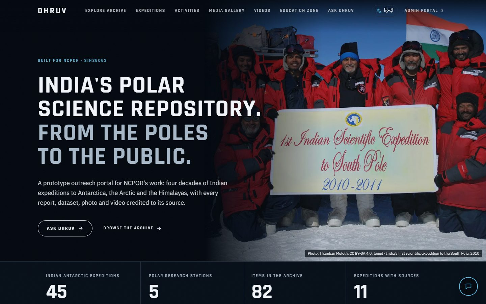

**Contents:** [Why we built this](#why-we-built-this) · [What it does](#what-it-does) · [Walkthrough](#walkthrough) · [How it's built](#how-its-built) · [Run it yourself](#run-it-yourself) · [What's next](#whats-next)

---

## Why we built this

India has been sending expeditions to Antarctica since 1981, and to the Arctic and the Himalaya since. The results are spread across PDFs, annual reports, YouTube videos, press releases and data portals. Most of it is in English, and much of it is hard to find.

NCPOR's outreach team is small. Turning one 170-page annual report into a news article, a press release, social posts in two languages and something a Class 7 student can learn from takes days.

DHRUV does that work in minutes. People still make every decision.

## What it does

**Upload once, get everything.** A scientist uploads a report, dataset, photo or video. DHRUV's AI reads it and makes:

- an English and a Hindi summary, keywords and alt text
- a public archive page with preview, download, citation and licence
- searchable passages, each tagged with its PDF page
- a website article and a press release
- posts for X, Instagram, LinkedIn and Facebook, in English and Hindi
- a lesson for students, with a quiz and a certificate that can be verified

Our real example: **NCPOR's Annual Report 2024-25** (19 MB, 170 pages) became 11 outputs. The AI catalogue was ready in 51 seconds.

**Nothing goes out without a person.** Every post needs a second staff member to approve it, and whoever made a draft can't approve it. Every step is written to an audit log with the name of the person who took it.

**Ask Dhruv shows its sources.** Anyone can ask a question in English or Hindi. Each answer cites its sources, down to the exact PDF page or the minute in a video. If the archive doesn't hold the answer, Dhruv says so instead of guessing.

**Tested in public.** We test Ask Dhruv against 32 fixed questions whose answers we checked by hand. The latest run got **26 of 26 facts right, with the right source**, and 5 of 6 honest "I don't know" answers. The failure is shown too. See `/accuracy`.

**Anyone can check a post.** Every approved post carries a QR code. Scanning it opens DHRUV and shows *Genuine*, *Not approved* or *No match*, with the exact approved text. A post edited after approval is easy to spot.

**Built for everyone.** The site is fully bilingual (English and Hindi, 511 interface texts in each) and designed for phones first. Automated WCAG 2.1 AA checks find 0 accessibility violations. Pages load in 1 to 2.3 seconds on a budget phone over 4G.

## Walkthrough

A tour of the app the way a visitor, a student and an NCPOR staff member would use it. All screenshots are from the running app with real, credited content.

### 1. Home: India's polar work at a glance

The home page opens on a real photo from India's first scientific expedition to the South Pole (2010), credited to the photographer. Under it are live numbers from the archive: 45 Indian Antarctic expeditions, 5 research stations, 82 archive items and 11 expeditions with sources.

### 2. The stations, live

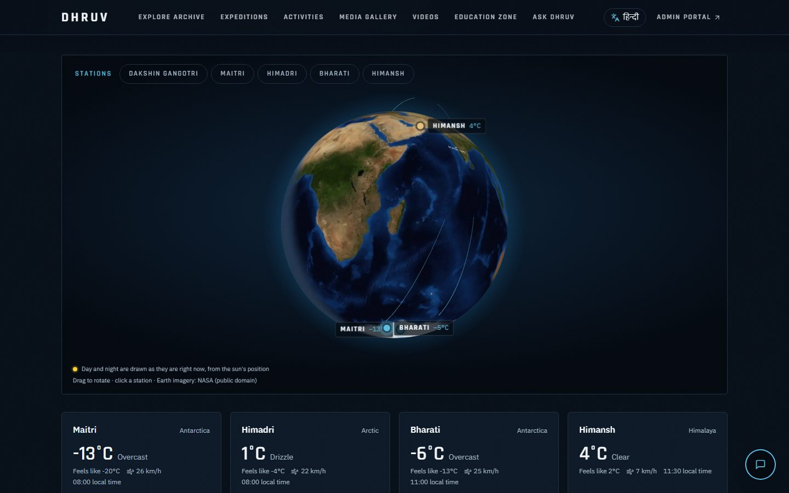

A 3D globe shows where Maitri, Bharati, Himadri and Himansh are. Day and night on the globe follow the real position of the sun, and each station card shows its current temperature and weather. Click a station to open its page with photos, reports and expeditions linked to it.

### 3. Explore the archive

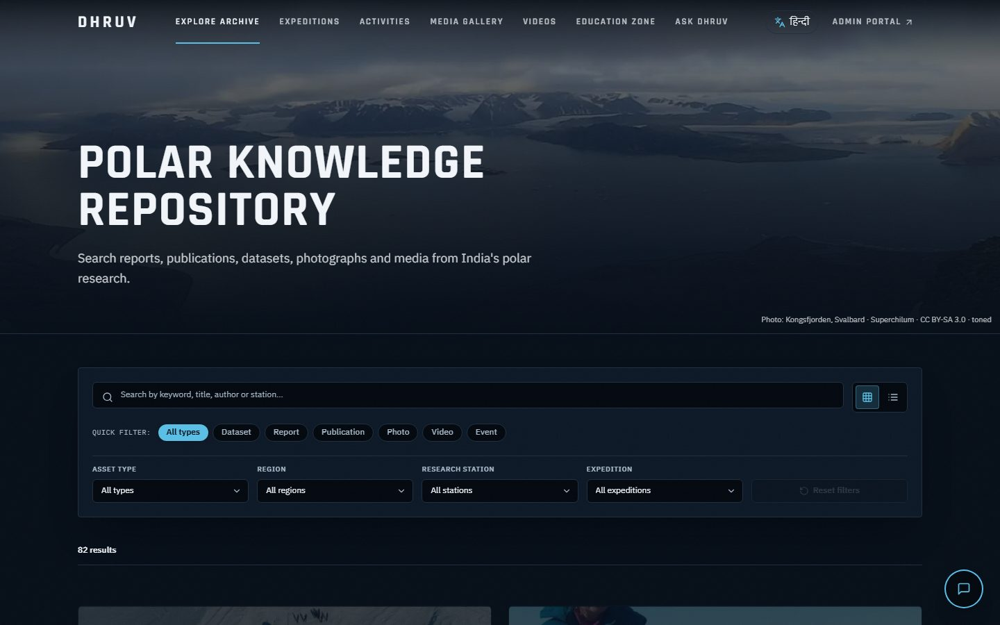

Every report, paper, dataset, photo, video and activity in one searchable place. Filter by type, region, station or expedition. Search works in English and Hindi: a Hindi search also finds items that were catalogued in English.

### 4. Ask Dhruv

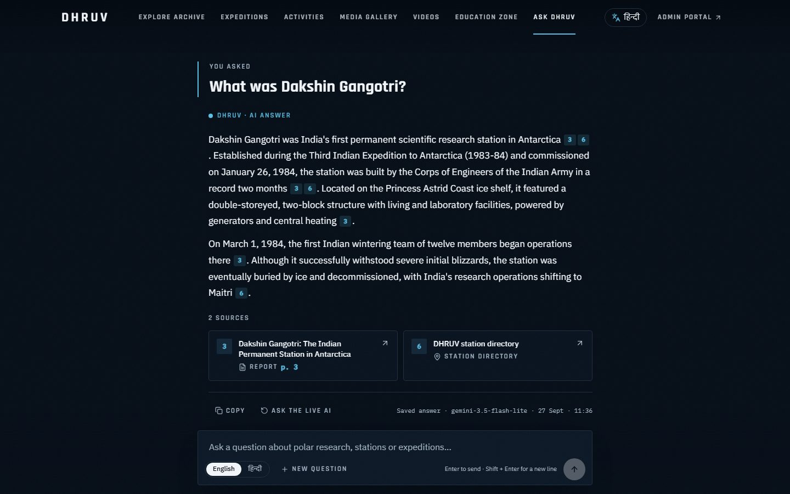

Ask a question in plain English or Hindi, for example *"What was Dakshin Gangotri?"*. Dhruv answers only from the archive. The small numbers in the answer are links to its sources, and each source card says what kind of source it is and which page it came from. Clicking a report source opens the PDF at that exact page; a video source starts the video at the right minute.

The sample questions have saved answers, so they open instantly even when the free AI service is busy. They are labelled "Saved answer", and **Ask the live AI** runs the question again live.

### 5. How accurate is it?

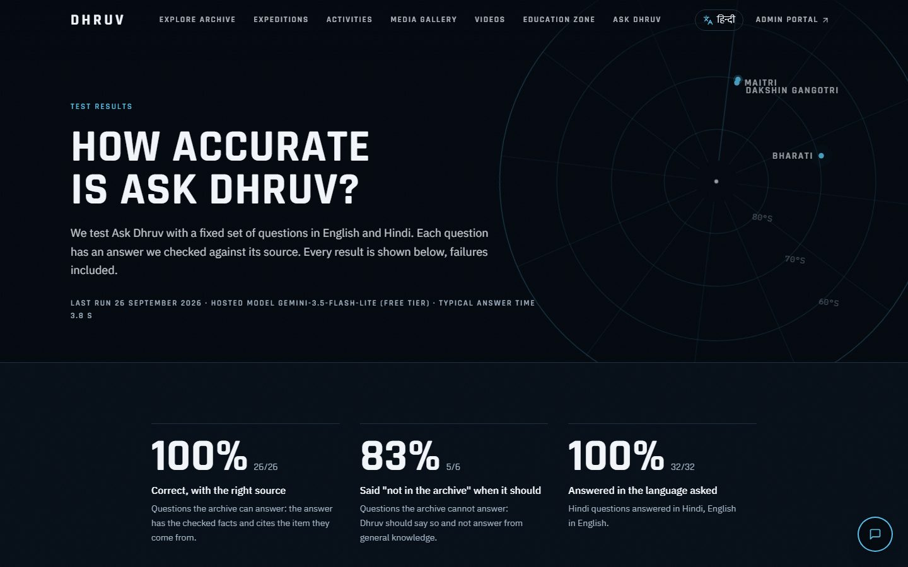

The `/accuracy` page shows the test results in public: 32 fixed questions, each with the answer we checked by hand and the answer Dhruv gave. Latest run: 26 of 26 facts right with the right source, 5 of 6 out-of-archive questions answered honestly with "not in the archive", and 32 of 32 answered in the language asked. The one failure stays on the page.

### 6. Expeditions with sources

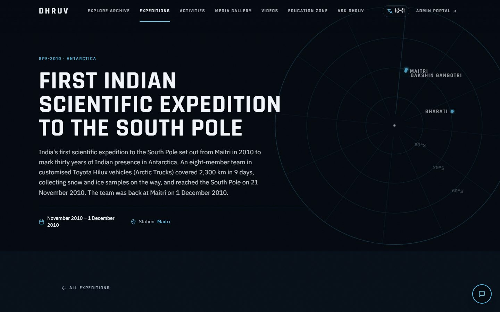

Each expedition page has its dates, team, a timeline and a route map, and every fact links to where it came from (NCPOR's own reports, news and videos). Expeditions we could not source are not shown.

### 7. Staff: upload once, get everything

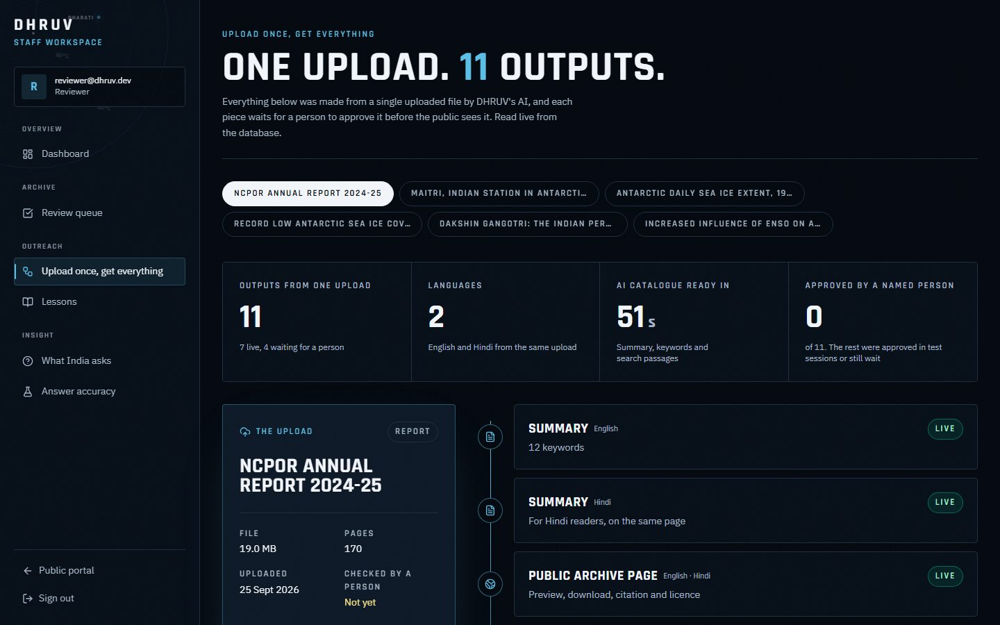

The staff side starts with an upload. This page shows what one upload became: the NCPOR Annual Report 2024-25 turned into 11 outputs, with summaries in both languages, a public page, 20 searchable passages cited to their pages, a website article, a press release, posts for four social networks and a lesson with a quiz. Each output shows whether it is live or still waiting, and the audit log at the bottom lists every step and who took it.

### 8. Staff dashboard

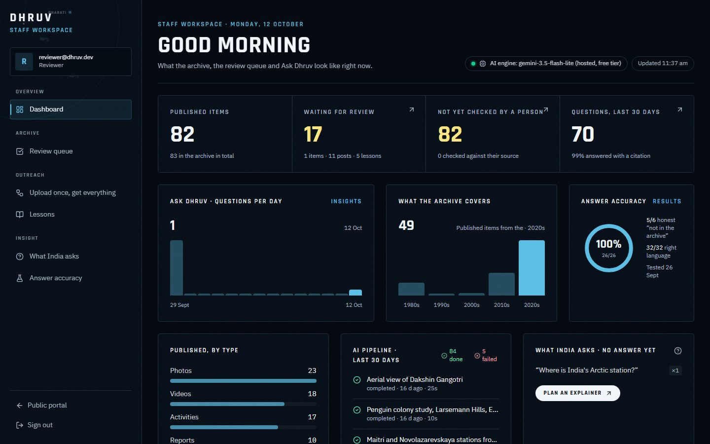

The dashboard is read live from the database: what is published, what is waiting for review, what has not been checked by a person yet, how many questions people asked each day, what the archive covers by decade, the AI pipeline's recent jobs, and the questions Dhruv could not answer (so staff know what content to add next).

### 9. A QR code on every approved post

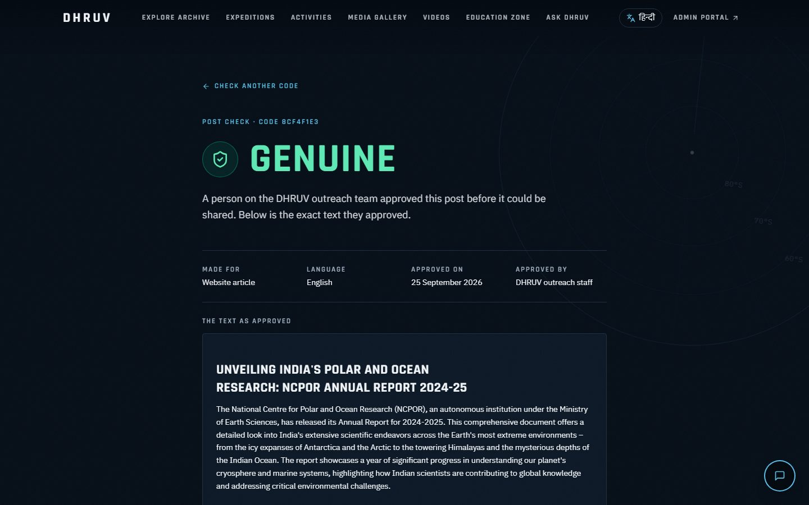

When a second staff member approves a post, it gets a QR code and an 8-character code. Staff can download a ready-to-share image with the QR on it. Anyone who scans it lands on this page and sees *Genuine*, with the exact approved text. A draft shows *Not approved*, and an unknown code shows *No match*.

### 10. Hindi everywhere, and on phones

<p>
  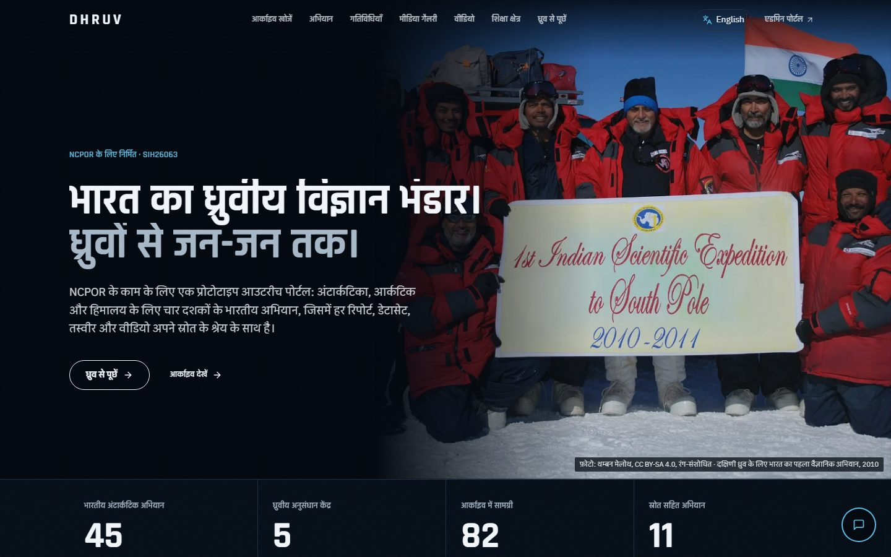
  &nbsp;
  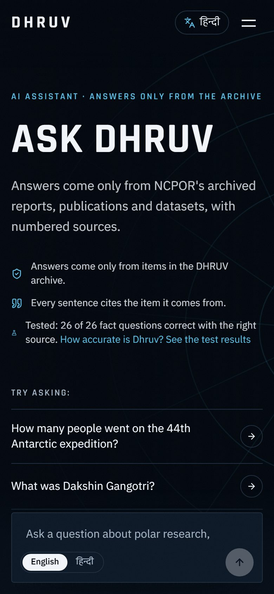
</p>

One click switches the whole site to Hindi: menus, pages, summaries and answers. Every page is designed for phones first.

### Page map

| Page | What's there |
|---|---|
| `/` | Home, live globe, expedition timeline |
| `/explore` | The whole archive with search and filters |
| `/ask` | Ask Dhruv |
| `/expeditions` | Sourced expedition pages |
| `/videos`, `/gallery`, `/events`, `/news` | Videos, photos, activities, news and RSS |
| `/learn` | Lessons, quizzes and certificates |
| `/accuracy` | Ask Dhruv's public scorecard |
| `/verify` | Check a certificate or a post's code |
| `/admin` | Staff dashboard, upload, review queue, content studio, lessons, insights |
| `/admin/pack` | One upload and everything it became |

## How it's built

```
Browser (Next.js 15, React, Tailwind v4, framer-motion, three.js globe)
   │
   ├── Public pages ──────────── Supabase Postgres (row-level security: public sees published items only)
   │                              ├── pgvector + full-text hybrid search
   ├── /api/chat (Ask Dhruv) ──── └── audit log, approval state machine
   │        │
   │        └── LLM (Gemini free tier, or Ollama on our own machine) + embeddings (Voyage or bge-m3)
   │
   └── /admin (staff) ─────────── upload → AI catalogue → drafts → second-person approval → publish
```

- **Open source and free to run.** Next.js, Postgres + pgvector and Supabase (which can be self-hosted) are all open source. The AI is swappable: the demo uses free hosted tiers, and a fully offline mode runs open-weight models (Gemma, Qwen, bge-m3) through Ollama on a normal laptop.
- **Honest data.** Items loaded by import scripts say "not yet checked by a person" until a reviewer checks them. We never show approvals that didn't happen.

More detail: [`SIH_PLAN.md`](SIH_PLAN.md) (design and decisions), [`SPEC.md`](SPEC.md) (data model and APIs), [`DESIGN.md`](DESIGN.md) (visual language), [`PRODUCTION_PLAN.md`](PRODUCTION_PLAN.md) (what a real deployment would still need).

## Run it yourself

You need **Node.js 20+** and a free **Supabase** project.

```powershell
git clone https://github.com/DINESH-7S/Polar-Knowledge-Repository-FOR-INDIA-SIH-2026.git
cd Polar-Knowledge-Repository-FOR-INDIA-SIH-2026
npm install
Copy-Item .env.example .env.local   # then fill in your own keys
npm run dev                         # http://localhost:3000
```

Then run the SQL files in `supabase/migrations/` in the Supabase SQL editor, oldest first, and `npm run seed` for the reference data and demo accounts.

| Command | What it does |
|---|---|
| `npm run dev` | Development server |
| `npm run test:e2e` | Playwright tests in English and Hindi, desktop and phone |
| `npm run a11y` | Accessibility audit (axe-core, WCAG 2.1 AA) |
| `npm run vitals` | Loading speed on a simulated budget phone |
| `npm run eval-ask` | Runs the 32-question accuracy test for Ask Dhruv |
| `npm run save-answers` | Refreshes the saved answers for the sample questions |

## What's next

- Asking by voice in Indian languages, through Bhashini
- Approved posts going live on NCPOR's channels automatically
- New NCPOR videos and news collected into the archive by themselves
- A classroom mode for teachers, and a monthly impact report for NCPOR

## Credits and licence

The **code** is under the [MIT licence](LICENSE). Archive **content** is not: each document, photo, video and dataset keeps its owner's licence, which is shown on its page. Sources include NCPOR's own repository, website and YouTube channel, PIB, Wikimedia Commons contributors, NSIDC and NASA (Blue Marble imagery).

Built by a student team for Smart India Hackathon 2026.
