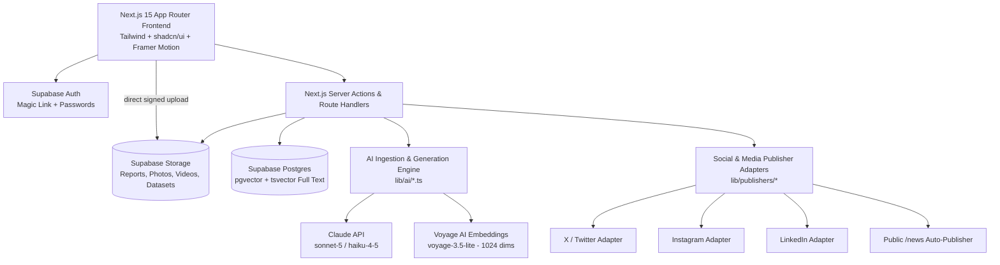

# DHRUV — Polar Knowledge & Outreach Platform
## System Architecture, Database Schema & API Specifications

**Problem Statement ID:** SIH26063 (Ministry of Earth Sciences / NCPOR, Goa)  
**Product Name:** DHRUV  
**Tagline:** "Upload once. Archive forever. Publish everywhere."  
**Theme:** Smart Education & Polar Science Outreach  

---

## 1. System Architecture Overview



### Technology Stack
- **Framework:** Next.js 15 (App Router, Server Actions, Route Handlers)
- **Language:** TypeScript Strict Mode
- **Styling & UI:** Tailwind CSS v4, shadcn/ui, Lucide Icons, Framer Motion
- **Database & Auth:** Supabase Postgres, Auth, Storage, RLS, pgvector extension
- **AI Models:** `@anthropic-ai/sdk`
  - `claude-sonnet-5` (Deep Summaries, RAG Chat, Social Campaigns, Lessons)
  - `claude-haiku-4-5-20251001` (Bulk Tagging, Image Vision Captions, Classification)
- **Embeddings:** Voyage AI `voyage-3.5-lite` with `output_dimension: 1024` stored in `pgvector` (note: the older `voyage-3-lite` outputs 512 dims and would fail inserts into `VECTOR(1024)`)
- **Search:** Postgres Hybrid Search (Full-Text `tsvector` + `pgvector` Cosine Distance via Reciprocal Rank Fusion)
- **Visuals:** `react-globe.gl` (3D Interactive Station Globe), `MapLibre GL` (2D Maps), `Recharts` (Analytics)
- **PDF Parser:** `unpdf` (~800 token chunking, 100 token overlap)
- **i18n:** `next-intl` (English `en`, Hindi `hi`)

---

## 2. Directory Structure Conventions

```
e:\PS 63
├── app
│   ├── (public)               # Public-facing Portal (Hero, Globe, Explore, Asset detail, Learn, Gallery, Stations)
│   │   ├── page.tsx           # Home page with 3D Globe
│   │   ├── explore            # Faceted search & discovery
│   │   ├── asset/[id]         # Asset details & AI summary viewer
│   │   ├── stations           # Polar stations showcase (Maitri, Bharati, Himadri, Himansh, Dakshin Gangotri)
│   │   ├── expeditions        # Interactive timeline 1981-present
│   │   ├── gallery            # Masonry image/video gallery
│   │   ├── news               # Auto-published stories & press releases
│   │   ├── ask                # "Ask Dhruv" RAG AI Assistant
│   │   ├── learn              # Smart Education Zone & Quiz flow
│   │   └── verify/[id]        # Digital Certificate verification
│   ├── admin                  # Backoffice / Dashboard (RBAC protected)
│   │   ├── page.tsx           # Overview & Analytics dashboard
│   │   ├── upload             # Drag & Drop AI multi-ingestion portal
│   │   ├── studio             # Content Dissemination Studio & Social campaign generator
│   │   ├── calendar           # Social post content calendar
│   │   ├── review             # Human approval queue & reviewer notes
│   │   └── users              # User RBAC management & audit logs
│   ├── api                    # API Route Handlers (Ingestion, RAG, Webhooks, Certificate PDF)
│   ├── layout.tsx             # Root layout with i18n & Theme Providers
│   └── globals.css            # Polar Design System Tokens & Tailwind setup
├── components
│   ├── ui                     # shadcn/ui base primitives
│   ├── public                 # Public portal components (Globe, Timeline, Lightbox, Chat)
│   ├── admin                  # Backoffice components (Uploader, Post Card, Reviewer tools)
│   └── shared                 # Navbar, Footer, Language Switcher, Citation Generator
├── lib
│   ├── ai                     # Claude API wrappers, Prompts, Chunking, Vision & Structured Zod Output
│   │   ├── claude.ts          # Client initialization & error retries
│   │   ├── embed.ts           # Voyage AI / pgvector embedding helper
│   │   ├── ingest.ts          # PDF/Image/Dataset AI ingestion workflow
│   │   ├── campaign.ts        # Social media & Press Release campaign generator
│   │   ├── rag.ts             # Hybrid search & context builder for Ask Dhruv
│   │   └── lesson.ts          # Educational lesson & MCQ generator
│   ├── db                     # Supabase client helpers (Server, Client, Middleware)
│   ├── publishers             # Social Media API Adapters (Mocked interfaces for X, LinkedIn, IG, Meta)
│   └── utils.ts               # Citation formatters, date utilities, helpers
├── supabase
│   ├── migrations             # SQL schema migrations & RLS policies
│   └── seed.sql               # Seed data for stations, expeditions, sample assets
├── scripts
│   └── seed.ts                # Creates demo auth users + roles via service-role admin API, sample posts/lessons
├── messages
│   ├── en.json                # next-intl English strings
│   └── hi.json                # next-intl Hindi strings
├── SPEC.md                    # System Specification (This file)
├── AGENTS.md                  # Development & Multi-agent guidelines
└── package.json
```

---

## 3. Database Schema & RLS Policies

```sql
-- Enable necessary extensions
CREATE EXTENSION IF NOT EXISTS "uuid-ossp";
CREATE EXTENSION IF NOT EXISTS "vector";

-- Enums
CREATE TYPE user_role AS ENUM ('super_admin', 'scientist', 'outreach_officer', 'reviewer', 'public');
CREATE TYPE polar_region AS ENUM ('antarctic', 'arctic', 'himalaya', 'southern_ocean');
CREATE TYPE station_status AS ENUM ('active', 'seasonal', 'decommissioned', 'historic');
CREATE TYPE asset_type AS ENUM ('report', 'publication', 'dataset', 'photo', 'video', 'event', 'news');
CREATE TYPE access_level AS ENUM ('public', 'restricted');
CREATE TYPE asset_status AS ENUM ('draft', 'processing', 'ready', 'published', 'archived');
CREATE TYPE social_channel AS ENUM ('x', 'instagram', 'linkedin', 'facebook', 'blog', 'press_release', 'newsletter');
CREATE TYPE post_status AS ENUM ('draft', 'in_review', 'approved', 'scheduled', 'published', 'rejected');
CREATE TYPE grade_band AS ENUM ('6-8', '9-10', '11-12');
CREATE TYPE ai_job_status AS ENUM ('pending', 'processing', 'completed', 'failed');

-- Profiles Table
CREATE TABLE profiles (
    id UUID PRIMARY KEY REFERENCES auth.users(id) ON DELETE CASCADE,
    full_name TEXT NOT NULL,
    role user_role NOT NULL DEFAULT 'public',
    avatar_url TEXT,
    created_at TIMESTAMPTZ DEFAULT NOW()
);

-- Expeditions Table
CREATE TABLE expeditions (
    id UUID PRIMARY KEY DEFAULT uuid_generate_v4(),
    name TEXT NOT NULL,
    code TEXT NOT NULL UNIQUE, -- e.g., "ISEA-43"
    region polar_region NOT NULL,
    start_date DATE NOT NULL,
    end_date DATE,
    leader TEXT NOT NULL,
    summary TEXT NOT NULL,
    route_geojson JSONB,
    cover_image TEXT,
    created_at TIMESTAMPTZ DEFAULT NOW()
);

-- Stations Table
CREATE TABLE stations (
    id UUID PRIMARY KEY DEFAULT uuid_generate_v4(),
    name TEXT NOT NULL UNIQUE,
    region polar_region NOT NULL,
    lat NUMERIC(9,6) NOT NULL,
    lng NUMERIC(9,6) NOT NULL,
    established_year INT NOT NULL,
    status station_status NOT NULL DEFAULT 'active',
    description TEXT NOT NULL,
    image TEXT NOT NULL,
    created_at TIMESTAMPTZ DEFAULT NOW()
);

-- Assets Table (Knowledge Repository Core)
CREATE TABLE assets (
    id UUID PRIMARY KEY DEFAULT uuid_generate_v4(),
    type asset_type NOT NULL,
    title TEXT NOT NULL,
    title_hi TEXT,
    description TEXT NOT NULL,
    file_path TEXT,            -- nullable: 'event' and 'news' assets may have no file
    mime_type TEXT,
    file_size BIGINT,
    thumbnail TEXT,
    expedition_id UUID REFERENCES expeditions(id) ON DELETE SET NULL,
    station_id UUID REFERENCES stations(id) ON DELETE SET NULL,
    region polar_region NOT NULL,
    discipline TEXT[] NOT NULL DEFAULT '{}',
    year INT NOT NULL,
    authors TEXT[] NOT NULL DEFAULT '{}',
    doi TEXT,
    license TEXT DEFAULT 'CC-BY-4.0',
    access_level access_level NOT NULL DEFAULT 'public',
    status asset_status NOT NULL DEFAULT 'draft',
    ai_summary TEXT,
    ai_summary_simple TEXT,
    ai_summary_hi TEXT,
    ai_keywords TEXT[] DEFAULT '{}',
    ai_caption TEXT,
    alt_text TEXT,
    search_tsv TSVECTOR,
    view_count INT DEFAULT 0,
    download_count INT DEFAULT 0,
    created_by UUID REFERENCES profiles(id) ON DELETE SET NULL,
    created_at TIMESTAMPTZ DEFAULT NOW(),
    published_at TIMESTAMPTZ
);

-- Full text search: trigger keeps search_tsv populated (English stemming + 'simple' for Hindi title)
CREATE OR REPLACE FUNCTION public.assets_tsv_update() RETURNS trigger
LANGUAGE plpgsql AS $$
BEGIN
    NEW.search_tsv :=
        setweight(to_tsvector('english', coalesce(NEW.title, '')), 'A') ||
        setweight(to_tsvector('simple',  coalesce(NEW.title_hi, '')), 'A') ||
        setweight(to_tsvector('english', array_to_string(coalesce(NEW.ai_keywords, '{}'), ' ')), 'B') ||
        setweight(to_tsvector('english', coalesce(NEW.description, '') || ' ' || coalesce(NEW.ai_summary, '')), 'C') ||
        setweight(to_tsvector('english', array_to_string(coalesce(NEW.authors, '{}'), ' ')), 'D');
    RETURN NEW;
END $$;

CREATE TRIGGER assets_tsv_trg BEFORE INSERT OR UPDATE ON assets
    FOR EACH ROW EXECUTE FUNCTION public.assets_tsv_update();

CREATE INDEX assets_search_tsv_idx ON assets USING GIN(search_tsv);

-- Asset Chunks (for Vector RAG Search + full-text search inside PDFs)
CREATE TABLE asset_chunks (
    id UUID PRIMARY KEY DEFAULT uuid_generate_v4(),
    asset_id UUID NOT NULL REFERENCES assets(id) ON DELETE CASCADE,
    chunk_index INT NOT NULL,
    content TEXT NOT NULL,
    content_tsv TSVECTOR GENERATED ALWAYS AS (to_tsvector('english', content)) STORED,
    embedding VECTOR(1024)
);

-- HNSW (not ivfflat): ivfflat built on an empty table gives bad recall on small demo data
CREATE INDEX asset_chunks_embedding_idx ON asset_chunks USING hnsw (embedding vector_cosine_ops);
CREATE INDEX asset_chunks_tsv_idx ON asset_chunks USING GIN(content_tsv);

-- Content Studio Posts
CREATE TABLE content_posts (
    id UUID PRIMARY KEY DEFAULT uuid_generate_v4(),
    asset_id UUID NOT NULL REFERENCES assets(id) ON DELETE CASCADE,
    channel social_channel NOT NULL,
    language VARCHAR(5) NOT NULL DEFAULT 'en',
    body TEXT NOT NULL,
    hashtags TEXT[] DEFAULT '{}',
    image_url TEXT,
    status post_status NOT NULL DEFAULT 'draft',
    scheduled_at TIMESTAMPTZ,
    reviewer_id UUID REFERENCES profiles(id) ON DELETE SET NULL,
    review_note TEXT,
    created_by UUID REFERENCES profiles(id) ON DELETE SET NULL,
    created_at TIMESTAMPTZ DEFAULT NOW()
);

-- Smart Education Lessons
CREATE TABLE lessons (
    id UUID PRIMARY KEY DEFAULT uuid_generate_v4(),
    asset_id UUID NOT NULL REFERENCES assets(id) ON DELETE CASCADE,
    title TEXT NOT NULL,
    grade_band grade_band NOT NULL,
    language VARCHAR(5) NOT NULL DEFAULT 'en',
    content_md TEXT NOT NULL,
    learning_objectives TEXT[] DEFAULT '{}',
    status asset_status NOT NULL DEFAULT 'published',
    created_at TIMESTAMPTZ DEFAULT NOW()
);

-- Educational Quizzes
CREATE TABLE quizzes (
    id UUID PRIMARY KEY DEFAULT uuid_generate_v4(),
    lesson_id UUID NOT NULL REFERENCES lessons(id) ON DELETE CASCADE,
    questions JSONB NOT NULL -- Array of { q, options: [], answer_index: number, explanation: string }
);

-- Quiz Attempts & Certificates
CREATE TABLE quiz_attempts (
    id UUID PRIMARY KEY DEFAULT uuid_generate_v4(),
    quiz_id UUID NOT NULL REFERENCES quizzes(id) ON DELETE CASCADE,
    user_name TEXT NOT NULL,
    school TEXT NOT NULL,
    score INT NOT NULL,
    certificate_id TEXT NOT NULL UNIQUE,
    created_at TIMESTAMPTZ DEFAULT NOW()
);

-- RAG Chat Logs
CREATE TABLE chat_logs (
    id UUID PRIMARY KEY DEFAULT uuid_generate_v4(),
    session_id TEXT NOT NULL,
    question TEXT NOT NULL,
    answer TEXT NOT NULL,
    cited_asset_ids UUID[] DEFAULT '{}',
    created_at TIMESTAMPTZ DEFAULT NOW()
);

-- Analytics Events
CREATE TABLE analytics_events (
    id UUID PRIMARY KEY DEFAULT uuid_generate_v4(),
    event TEXT NOT NULL, -- 'view', 'download', 'search', 'share', 'chat', 'quiz_complete'
    asset_id UUID REFERENCES assets(id) ON DELETE SET NULL,
    meta JSONB DEFAULT '{}',
    created_at TIMESTAMPTZ DEFAULT NOW()
);

-- AI Ingestion Job Tracker
CREATE TABLE ai_jobs (
    id UUID PRIMARY KEY DEFAULT uuid_generate_v4(),
    asset_id UUID NOT NULL REFERENCES assets(id) ON DELETE CASCADE,
    job_type TEXT NOT NULL,
    status ai_job_status NOT NULL DEFAULT 'pending',
    error TEXT,
    tokens_in INT DEFAULT 0,
    tokens_out INT DEFAULT 0,
    created_at TIMESTAMPTZ DEFAULT NOW(),
    finished_at TIMESTAMPTZ
);

-- Audit Log
CREATE TABLE audit_log (
    id UUID PRIMARY KEY DEFAULT uuid_generate_v4(),
    actor_id UUID REFERENCES profiles(id) ON DELETE SET NULL,
    action TEXT NOT NULL,
    entity TEXT NOT NULL,
    entity_id UUID NOT NULL,
    diff JSONB,
    created_at TIMESTAMPTZ DEFAULT NOW()
);

-- ============================================================
-- AUTH HELPERS
-- ============================================================
-- Role of the current user. SECURITY DEFINER avoids RLS recursion on profiles.
CREATE OR REPLACE FUNCTION public.app_role() RETURNS user_role
LANGUAGE sql STABLE SECURITY DEFINER SET search_path = public AS $$
    SELECT COALESCE((SELECT role FROM profiles WHERE id = auth.uid()), 'public'::user_role)
$$;

CREATE OR REPLACE FUNCTION public.is_staff() RETURNS boolean
LANGUAGE sql STABLE AS $$ SELECT public.app_role() <> 'public' $$;

-- Every new auth user gets a profile with role 'public'.
-- Roles are ONLY raised by a super_admin (or scripts/seed.ts via service role) — never self-assigned.
CREATE OR REPLACE FUNCTION public.handle_new_user() RETURNS trigger
LANGUAGE plpgsql SECURITY DEFINER SET search_path = public AS $$
BEGIN
    INSERT INTO profiles (id, full_name)
    VALUES (NEW.id, COALESCE(NEW.raw_user_meta_data->>'full_name', NEW.email));
    RETURN NEW;
END $$;

CREATE TRIGGER on_auth_user_created AFTER INSERT ON auth.users
    FOR EACH ROW EXECUTE FUNCTION public.handle_new_user();

-- ============================================================
-- ROW LEVEL SECURITY — enabled on EVERY table.
-- Supabase exposes all public tables via the anon key; a table without RLS is world-writable.
-- Server-only writes (chunks, ai_jobs, analytics, chat_logs, quiz_attempts, audit_log)
-- go through the service-role client in lib/db/admin.ts (import 'server-only').
-- ============================================================
ALTER TABLE profiles          ENABLE ROW LEVEL SECURITY;
ALTER TABLE expeditions       ENABLE ROW LEVEL SECURITY;
ALTER TABLE stations          ENABLE ROW LEVEL SECURITY;
ALTER TABLE assets            ENABLE ROW LEVEL SECURITY;
ALTER TABLE asset_chunks      ENABLE ROW LEVEL SECURITY;
ALTER TABLE content_posts     ENABLE ROW LEVEL SECURITY;
ALTER TABLE lessons           ENABLE ROW LEVEL SECURITY;
ALTER TABLE quizzes           ENABLE ROW LEVEL SECURITY;
ALTER TABLE quiz_attempts     ENABLE ROW LEVEL SECURITY;
ALTER TABLE chat_logs         ENABLE ROW LEVEL SECURITY;
ALTER TABLE analytics_events  ENABLE ROW LEVEL SECURITY;
ALTER TABLE ai_jobs           ENABLE ROW LEVEL SECURITY;
ALTER TABLE audit_log         ENABLE ROW LEVEL SECURITY;

-- profiles: self or staff can read; only super_admin can change roles
CREATE POLICY profiles_read   ON profiles FOR SELECT USING (id = auth.uid() OR is_staff());
CREATE POLICY profiles_admin  ON profiles FOR UPDATE USING (app_role() = 'super_admin')
                                                    WITH CHECK (app_role() = 'super_admin');

-- stations / expeditions: public read, scientist + admin write
CREATE POLICY stations_read    ON stations    FOR SELECT USING (true);
CREATE POLICY stations_write   ON stations    FOR ALL USING (app_role() IN ('super_admin','scientist'))
                                                     WITH CHECK (app_role() IN ('super_admin','scientist'));
CREATE POLICY expeditions_read  ON expeditions FOR SELECT USING (true);
CREATE POLICY expeditions_write ON expeditions FOR ALL USING (app_role() IN ('super_admin','scientist'))
                                                      WITH CHECK (app_role() IN ('super_admin','scientist'));

-- assets: public sees only published+public; staff see everything
CREATE POLICY assets_public_read ON assets FOR SELECT USING (status = 'published' AND access_level = 'public');
CREATE POLICY assets_staff_read  ON assets FOR SELECT USING (is_staff());
CREATE POLICY assets_insert      ON assets FOR INSERT WITH CHECK (app_role() IN ('super_admin','scientist'));
CREATE POLICY assets_update      ON assets FOR UPDATE USING (app_role() IN ('super_admin','scientist','reviewer'))
                                                     WITH CHECK (app_role() IN ('super_admin','scientist','reviewer'));
CREATE POLICY assets_delete      ON assets FOR DELETE USING (app_role() = 'super_admin');

-- asset_chunks: visible only if the parent asset is visible to the caller (RLS on assets applies
-- inside the subquery) — this is what stops Ask Dhruv leaking restricted documents.
CREATE POLICY chunks_read ON asset_chunks FOR SELECT
    USING (EXISTS (SELECT 1 FROM assets a WHERE a.id = asset_chunks.asset_id));

-- content_posts: public sees published; outreach/reviewer/admin manage.
-- "Reviewer must differ from creator" is enforced in the approve Server Action.
CREATE POLICY posts_public_read ON content_posts FOR SELECT USING (status = 'published');
CREATE POLICY posts_staff       ON content_posts FOR ALL
    USING (app_role() IN ('super_admin','outreach_officer','reviewer'))
    WITH CHECK (app_role() IN ('super_admin','outreach_officer','reviewer'));

-- lessons: public sees published; staff manage
CREATE POLICY lessons_public_read ON lessons FOR SELECT USING (status = 'published');
CREATE POLICY lessons_staff       ON lessons FOR ALL USING (is_staff()) WITH CHECK (is_staff());

-- quizzes: NO public read (questions JSON contains answer_index).
-- Public quiz page gets questions WITHOUT answers from a server route; grading happens server-side.
CREATE POLICY quizzes_staff ON quizzes FOR ALL USING (is_staff()) WITH CHECK (is_staff());

-- Staff-only read for logs; all inserts via service role on the server
CREATE POLICY attempts_staff_read  ON quiz_attempts    FOR SELECT USING (is_staff());
CREATE POLICY chat_staff_read      ON chat_logs        FOR SELECT USING (is_staff());
CREATE POLICY analytics_staff_read ON analytics_events FOR SELECT USING (is_staff());
CREATE POLICY jobs_staff_read      ON ai_jobs          FOR SELECT USING (is_staff());
CREATE POLICY audit_admin_read     ON audit_log        FOR SELECT USING (app_role() = 'super_admin');

-- ============================================================
-- HYBRID SEARCH RPC (full-text + vector, Reciprocal Rank Fusion)
-- SECURITY INVOKER (default) so RLS applies. Ask Dhruv MUST call this with the
-- anon/user Supabase client — never the service-role client — or restricted content leaks.
-- ============================================================
CREATE OR REPLACE FUNCTION public.hybrid_search(
    query_text TEXT,
    query_embedding VECTOR(1024),
    match_count INT DEFAULT 8,
    full_text_weight FLOAT DEFAULT 1,
    semantic_weight FLOAT DEFAULT 1,
    rrf_k INT DEFAULT 50
) RETURNS TABLE (chunk_id UUID, asset_id UUID, content TEXT, score FLOAT)
LANGUAGE sql STABLE AS $$
WITH full_text AS (
    SELECT c.id,
           row_number() OVER (ORDER BY ts_rank_cd(c.content_tsv, websearch_to_tsquery('english', query_text)) DESC) AS rank_ix
    FROM asset_chunks c
    WHERE c.content_tsv @@ websearch_to_tsquery('english', query_text)
    ORDER BY rank_ix
    LIMIT match_count * 2
),
semantic AS (
    SELECT c.id,
           row_number() OVER (ORDER BY c.embedding <=> query_embedding) AS rank_ix
    FROM asset_chunks c
    WHERE c.embedding IS NOT NULL
    ORDER BY rank_ix
    LIMIT match_count * 2
)
SELECT c.id, c.asset_id, c.content,
       COALESCE(1.0 / (rrf_k + ft.rank_ix), 0.0) * full_text_weight +
       COALESCE(1.0 / (rrf_k + s.rank_ix),  0.0) * semantic_weight AS score
FROM full_text ft
FULL OUTER JOIN semantic s ON ft.id = s.id
JOIN asset_chunks c ON c.id = COALESCE(ft.id, s.id)
ORDER BY score DESC
LIMIT match_count;
$$;
```

### Storage Buckets
| Bucket | Public? | Contents | Access |
|---|---|---|---|
| `public-media` | yes | Thumbnails, published photos, OG images | Direct CDN URL |
| `archive` | no | All original uploads (PDFs, datasets, videos, restricted items) | Server issues signed URLs (60 min) after checking the asset is visible to the caller |

Storage policies: only `super_admin`/`scientist` may insert into `archive`; only the service role writes `public-media`.

---

## 4. API Endpoints & Server Actions Specifications

| Endpoint / Action | Method | Role | Description |
|---|---|---|---|
| Server Action `createUploadUrl` | — | Scientist, Admin | Creates the `assets` row (status `processing`) and returns a Supabase **signed upload URL**; the browser uploads the file directly to Storage |
| `app/api/ingest/route.ts` | `POST` | Scientist, Admin | Body: `{ assetId }` only — **never file bytes** (Vercel caps request bodies at 4.5 MB). Creates an `ai_jobs` row, returns `{ jobId }` immediately, runs extract → chunk → embed → Claude in `after()` with `export const maxDuration = 300`. UI polls `ai_jobs` / uses Supabase Realtime |
| `app/api/campaign/route.ts` | `POST` | Outreach, Admin | Generate multi-channel social campaign & Press release from Asset ID |
| `app/api/chat/route.ts` | `POST` | Public | Stream RAG response for "Ask Dhruv" with cited document IDs |
| `app/api/education/lesson/route.ts` | `POST` | Scientist, Admin | Auto-generate Grade 6-8/9-10/11-12 lesson & 5 MCQ quiz from asset |
| `app/api/education/quiz/[id]/route.ts` | `GET` | Public | Returns quiz questions + options **without** `answer_index` / explanations |
| `app/api/education/quiz/[id]/submit/route.ts` | `POST` | Public | Body `{ answers: number[], user_name, school }`. **Server grades**, stores `quiz_attempts`, issues `certificate_id` only if score ≥ 80%, returns explanations |
| `app/api/education/certificate/[certId]/route.ts` | `GET` | Public | Renders the PDF certificate for an existing passing attempt (cannot mint new ones) |
| `app/api/og/route.ts` | `GET` | Public | Dynamic OpenGraph share card generator with Polar styling |
| `app/api/analytics/track/route.ts` | `POST` | Public | Log asset view, download, search, share, or quiz completion event |

---

## 5. UI Design System & Color Palette

**Superseded — the binding design system is AGENTS.md §3a** (Eczar headings, IBM Plex Sans Devanagari body, IBM Plex Mono for IDs; CSS variables `--navy`, `--navy-raised`, `--ink`, `--line`, `--snow`, `--mist`, and `--glacier` as the single accent; no gradient text). Do not use Inter, Playfair Display or a second accent colour.

---

## 6. Implementation Workflow & Demo Validation Path

1. **Scientist Flow:** Upload Antarctic Expedition Report PDF -> AI Pipeline auto-summarizes (Scientific, Simple, Hindi) and auto-tags.
2. **Outreach Flow:** Click "Generate Campaign" -> AI creates X post, LinkedIn summary, IG caption, Press Release, and OG Share image.
3. **Reviewer Flow:** Approve social posts with reviewer note -> Approved posts render in Content Calendar and auto-publish to `/news`.
4. **Public Flow:** Interactive 3D Globe click on Maitri station -> view latest research, ask "Ask Dhruv" chatbot with citations.
5. **Student Flow:** Open Class 9 Polar Glacier Lesson -> Take Quiz -> Earn & verify a DHRUV learning certificate (a prototype certificate, not issued by NCPOR, MoES or the Government of India).

---

## 7. Cross-Cutting Decisions (binding for all agents)

### 7.1 i18n
`next-intl` **without i18n routing**: locale stored in the `NEXT_LOCALE` cookie, switched by the navbar toggle, strings in `messages/en.json` + `messages/hi.json`. Routes stay exactly as in §2 (no `[locale]` segment). DB content uses the `*_hi` columns.

### 7.2 Supabase clients (`lib/db`)
- `server.ts` — cookie-based user client for Server Components/Actions (RLS applies).
- `client.ts` — browser client (anon key only).
- `admin.ts` — service-role client, starts with `import 'server-only'`. Use only for server-side writes listed in §3; never for public reads.
- Every Server Action re-checks `app_role()` server-side; hiding a button is not authorization.

### 7.3 AI layer (`lib/ai`)
- All model outputs use structured output validated with Zod; one retry on validation failure. The provider is chosen by `AI_PROVIDER` behind `lib/ai/llm.ts` (`gemini` today; `ollama` open-weight models in Phase 1 — see PRODUCTION_PLAN.md: the stack must be open source and free). `claude` remains an optional paid provider, not the default.
- `AI_MOCK=true` → every `lib/ai` function returns deterministic fixture JSON from `lib/ai/fixtures/` with a short artificial delay. Used for offline demos and when API credits run out. The demo must work end-to-end in mock mode.
- Every call writes `tokens_in` / `tokens_out` to `ai_jobs`.
- `/api/chat` and `/api/campaign` are rate-limited (in-memory today; Postgres-backed counters in Phase 1).

### 7.4 Environment variables (`.env.example`)
```
NEXT_PUBLIC_SUPABASE_URL=
NEXT_PUBLIC_SUPABASE_ANON_KEY=
SUPABASE_SERVICE_ROLE_KEY=
ANTHROPIC_API_KEY=
VOYAGE_API_KEY=
AI_MOCK=false
NEXT_PUBLIC_SITE_URL=http://localhost:3000
```

### 7.5 Build Order & Priorities (32-hour budget)
| Priority | Scope | Rule |
|---|---|---|
| **P0** | Scaffold + auth + migrations + seed → Module 1 Repository → Module 2 AI Pipeline → Module 3 Content Studio (generate, review, approve, publish to `/news`) → Module 4 Public Portal (home + globe, explore, asset detail, stations, expeditions, news) | Must be flawless. Nothing else starts until the P0 demo path works on the deployed URL. |
| **P1** | Module 5 Ask Dhruv; Module 6 Learn (lesson + quiz + certificate); gallery; content calendar | Build only after P0 is green. |
| **P2** | Module 7 analytics dashboard, user management UI, audit log viewer | Seeded/read-only views are acceptable. |

**Feature freeze at hour 29.** After that: bug fixes, seed content, deployment, demo recording only.
